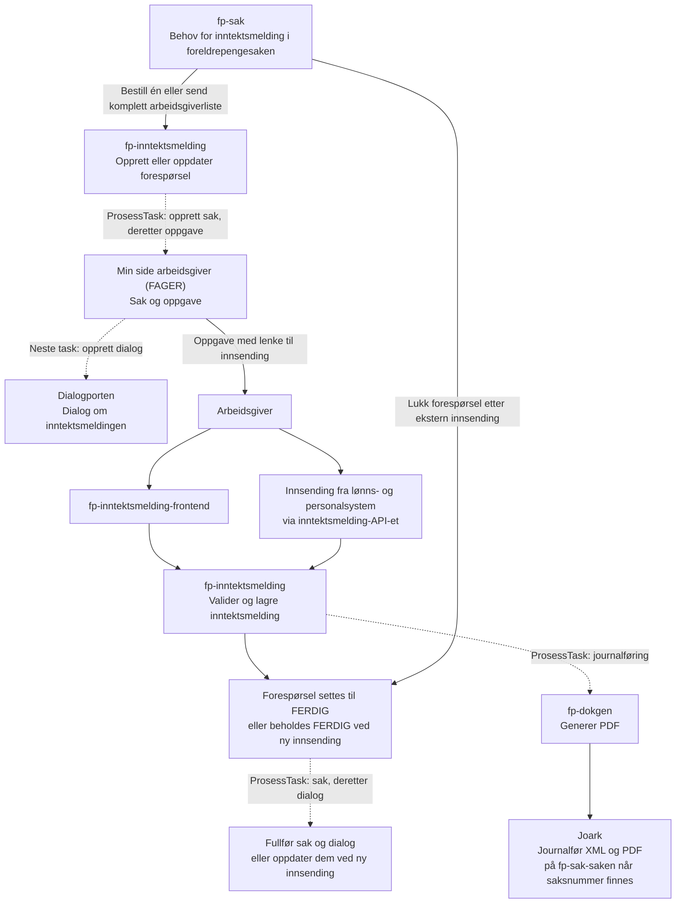
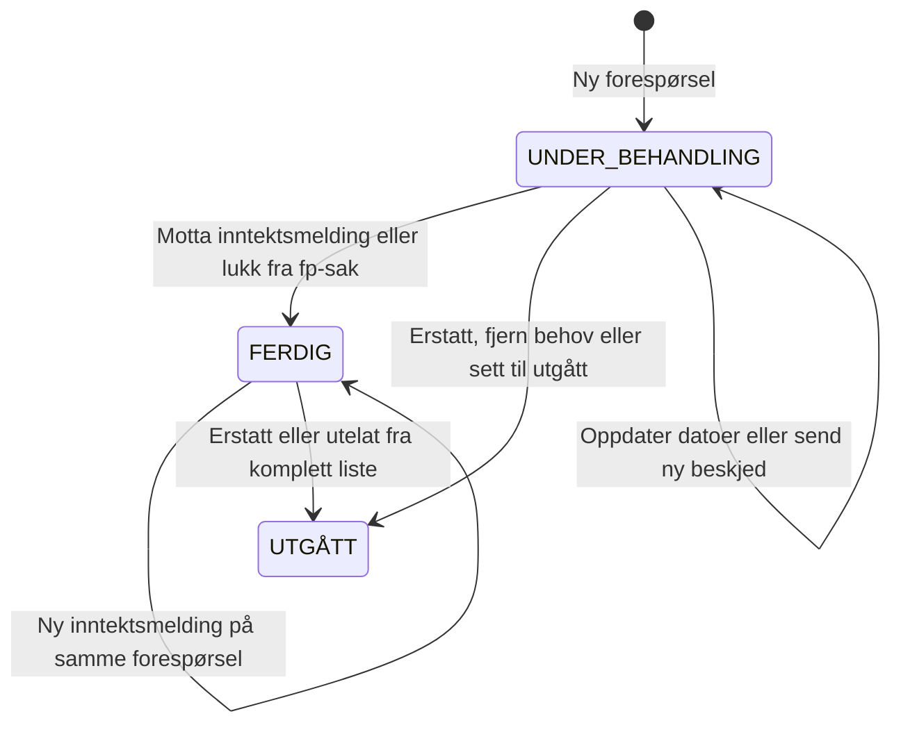

# fp-inntektsmelding

***

Backend for inntektsmelding for Team Foreldrepenger

## Oppdatere graphql skjema til Arbeidsgiver Notifikasjon API

Bytt ut [produsent.graphql](./src/main/resources/graphql/produsent.graphql) med SDL skjemaet som man kan lastes ned fra playground i
arbeidsgiver-notifikasjon sitt [notifikasjon-fake-produsent-api](https://notifikasjon-fake-produsent-api.ekstern.dev.nav.no/)

Oppdatert `schema.graphql` kan hentes [herfra](https://github.com/navikt/arbeidsgiver-notifikasjon-produsent-api/blob/main/app/src/main/resources/produsent.graphql).

## Architecture Summary

**REST Layer (11 endpoints):**
- `InntektsmeldingDialogRest` — Main employer dialog (TokenX) `/imdialog`
- `ArbeidsgiverinitiertDialogRest` — Employer-initiated flows (TokenX) `/arbeidsgiverinitiert`
- `PdfDokumentRest` — PDF receipt downloads (TokenX) `/pdf`
- `ForespørselRest` — Forespørsel management from fpsak (Azure) `/foresporsel`
- `ForespørselApiRest` — External forespørsel queries (Azure) `/imapi/foresporsel`
- `InntektsmeldingApiRest` — Fetch inntektsmelding by UUID (Azure) `/imapi/inntektsmelding`
- `InntektsmeldingFpsakRest` — Override inntektsmelding from saksbehandler (Azure) `/overstyring`
- `OppgaverForvaltningRestTjeneste` — Admin/drift task management (Azure) `/forvaltningOppgaver`
- `DialogportenForvaltningRestTjeneste` — Dialogporten admin (Azure) `/dialogporten`
- `ProsessTaskRestTjeneste` — Prosesstask admin (Azure) `/prosesstask`
- `ForespørselVtpRest` — VTP test support (Azure) `/foresporsel`

**Service Layer (13 tjenester):**
- `ForespørselBehandlingTjeneste` — Main orchestrator for forespørsel lifecycle
- `ForespørselTjeneste` — Thin CRUD wrapper around ForespørselRepository
- `ForespørselApiTjeneste` — External API queries (wraps ForespørselBehandlingTjeneste + PersonTjeneste)
- `InntektsmeldingMottakTjeneste` — Receives and processes new inntektsmeldinger
- `InntektsmeldingTjeneste` — CRUD for inntektsmeldinger
- `InntektsmeldingOverstyringTjeneste` — Handles overridden inntektsmeldinger
- `InntektsmeldingXMLTjeneste` — XML generation for inntektsmeldinger
- `GrunnlagDtoTjeneste` — Assembles dialog DTOs from multiple sources
- `KvitteringTjeneste` — PDF generation for receipts
- `DokumentGeneratorTjeneste` — Document generation via fp-dokgen
- `TilgangTjeneste` — Access control orchestration
- `PipTjeneste` — Policy Information Point for access control
- `AltinnTilgangTjeneste` — Altinn permission checks

**Repository Layer (2 repositories → PostgreSQL):**
- `ForespørselRepository` — Manages `ForespørselEntitet` (forespørsel table)
- `InntektsmeldingRepository` — Manages `InntektsmeldingEntitet` (inntektsmelding table)

## Verdikjede og tilstander for forespørsler

`fp-sak` behandler foreldrepengesaken og bestiller inntektsmeldinger fra arbeidsgivere.
`fp-inntektsmelding` håndterer forespørslene, gjør dem tilgjengelige for arbeidsgiver og tar imot inntektsmeldingene.
Tjenesten lagrer inntektsmeldingen og journalfører den i Joark som grunnlag for videre saksbehandling.
Den fatter ikke vedtak om foreldrepenger.

### Plass i verdikjeden

Heltrukne piler viser den funksjonelle flyten. Stiplede piler viser arbeid som utføres asynkront med ProsessTask.
Saker og dialoger opprettes og fullføres hos FAGER og Dialogporten i ordnede task-grupper.
Journalføring er en separat task, så `FERDIG` betyr ikke at journalføring eller eksterne oppdateringer er fullført.
Diagrammet stopper ved Joark for dokumentflyten. Journalføringstasken sender ikke inntektsmeldingen direkte til `fp-sak`.

Arbeidsgiver kan også sende en inntektsmelding uten en bestilling fra `fp-sak`.
Når denne arbeidsgiverinitierte flyten oppretter en ny forespørsel, setter tjenesten den til `FERDIG` under mottaket.
Eksterne saker og dialoger opprettes og fullføres etterpå.

### Tilstandsmaskin for en forespørsel

Statusene gjelder `ForespørselEntitet`, ikke saksbehandlingen i `fp-sak` eller statusen på en inntektsmelding.

| Status | Betydning |
|--------|-----------|
| `UNDER_BEHANDLING` | Forespørselen er åpen. Dette er startstatusen for en ny forespørsel. |
| `FERDIG` | Tjenesten har mottatt inntektsmeldingen, eller `fp-sak` har meldt at forespørselen skal lukkes etter ekstern innsending. Arbeidsgiver kan fortsatt sende en ny inntektsmelding på forespørselen. |
| `UTGÅTT` | Forespørselen er ikke lenger aktuell. Ordinær innsending på denne forespørselen avvises. |

Diagrammet viser tjenesteflytene, ikke en overgangsmatrise som databasen håndhever.
Metodene i repositoryet som setter status, kontrollerer ikke forrige status.
Det finnes ingen ordinær overgang som gjenåpner en `UTGÅTT` forespørsel. Ved nytt behov opprettes en ny.

### Hva utløser endringene?

| Hendelse | Virkning på forespørselen |
|----------|--------------------------|
| `fp-sak` bestiller én forespørsel (`/foresporsel/opprett-en`) | En identisk, ikke-utgått forespørsel gjenbrukes. Ellers settes tidligere ikke-utgåtte forespørsler for samme sak, aktør og arbeidsgiver til `UTGÅTT`, og en ny opprettes. Også en tidligere `FERDIG` forespørsel kan dermed bli `UTGÅTT`. |
| `fp-sak` sender komplett liste (`/foresporsel/opprett-komplett`) | Forespørsler bestilt av fagsystemet for aktuell sak, aktør og ytelse settes til `UTGÅTT` dersom arbeidsgiveren mangler i listen. En tom liste fjerner alle slike behov. Arbeidsgiverinitierte forespørsler omfattes ikke av denne oppryddingen. |
| Første uttaksdato endres for en eksisterende forespørsel i komplett liste | Datoene oppdateres på samme forespørsel, tidligere verdier lagres i historikk, og eksterne oppdateringer legges i kø. Statusen beholdes, også når den er `FERDIG`. Hvis bare skjæringstidspunktet endres, mens første uttaksdato er lik, returnerer denne flyten uten å oppdatere datoene. |
| Arbeidsgiver sender inn via frontend eller inntektsmelding-API-et | En åpen forespørsel settes til `FERDIG`. Ved ny innsending på en `FERDIG` forespørsel beholdes statusen, og eksterne oppdateringer legges i kø. |
| `fp-sak` kaller `/foresporsel/lukk` | Åpne forespørsler som matcher sak og eventuelt arbeidsgiver og skjæringstidspunkt, settes til `FERDIG`. Dette er et lukkesignal, ikke mottak eller journalføring av selve inntektsmeldingen. |
| `fp-sak` kaller `/foresporsel/sett-til-utgatt` | Åpne forespørsler som matcher filtrene, settes til `UTGÅTT`. Forvaltning og opprydding kan også sette forespørsler til `UTGÅTT`. |
| Saksbehandler sender ny beskjed (`/foresporsel/ny-beskjed`) | Krever en åpen forespørsel og endrer ikke statusen. |

Flytene er implementert i [ForespørselBehandlingTjeneste](src/main/java/no/nav/foreldrepenger/inntektsmelding/forespørsel/tjenester/ForespørselBehandlingTjeneste.java)
og [FellesMottakTjeneste](src/main/java/no/nav/foreldrepenger/inntektsmelding/inntektsmelding/FellesMottakTjeneste.java).
[ForespørselStatus](src/main/java/no/nav/foreldrepenger/inntektsmelding/typer/kodeverk/ForespørselStatus.java) definerer statusene.
