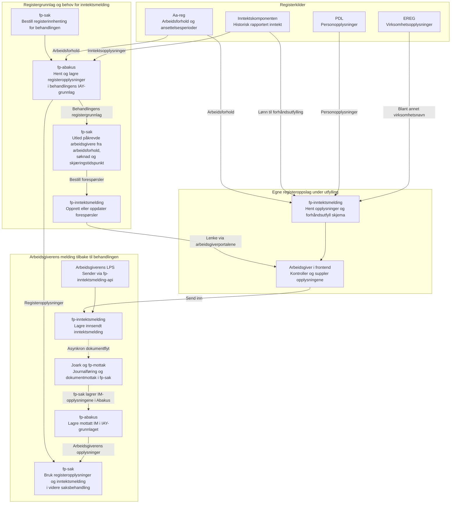
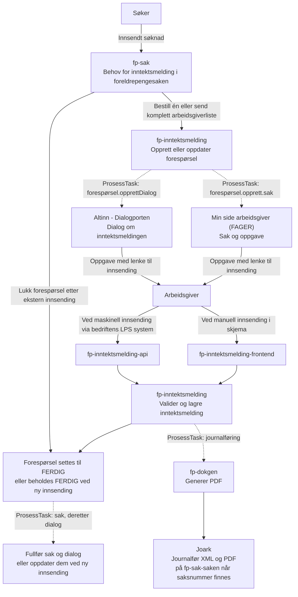
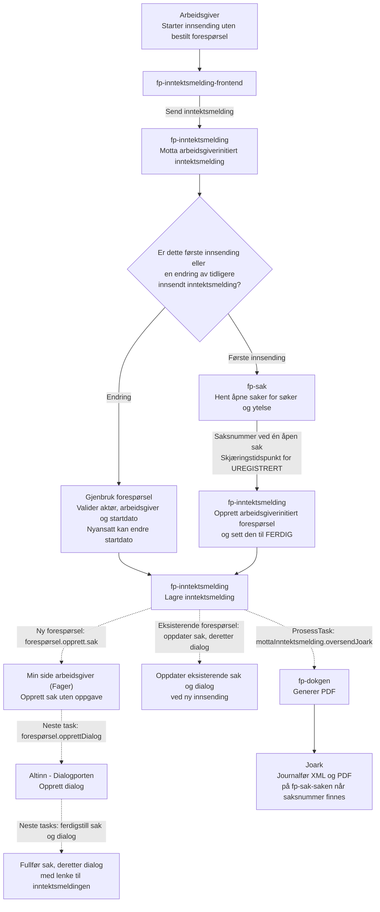
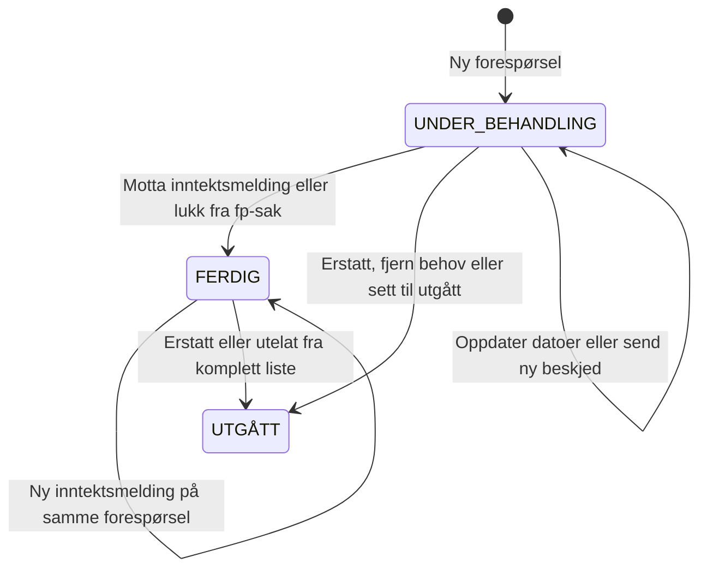

# fp-inntektsmelding

***

Backend for inntektsmelding for Team Foreldrepenger

## Oppdatere graphql skjema til Arbeidsgiver Notifikasjon API

Bytt ut [produsent.graphql](./src/main/resources/graphql/produsent.graphql) med SDL skjemaet som man kan lastes ned fra playground i
arbeidsgiver-notifikasjon sitt [notifikasjon-fake-produsent-api](https://notifikasjon-fake-produsent-api.ekstern.dev.nav.no/)

Oppdatert `schema.graphql` kan hentes [herfra](https://github.com/navikt/arbeidsgiver-notifikasjon-produsent-api/blob/main/app/src/main/resources/produsent.graphql).

## Architecture Summary

**REST Layer (11 endpoints):**
- `InntektsmeldingDialogRest` — Main employer dialog (TokenX) `/imdialog`
- `ArbeidsgiverinitiertDialogRest` — Employer-initiated flows (TokenX) `/arbeidsgiverinitiert`
- `PdfDokumentRest` — PDF receipt downloads (TokenX) `/pdf`
- `ForespørselRest` — Forespørsel management from fpsak (Azure) `/foresporsel`
- `ForespørselApiRest` — External forespørsel queries (Azure) `/imapi/foresporsel`
- `InntektsmeldingApiRest` — Fetch inntektsmelding by UUID (Azure) `/imapi/inntektsmelding`
- `InntektsmeldingFpsakRest` — Override inntektsmelding from saksbehandler (Azure) `/overstyring`
- `OppgaverForvaltningRestTjeneste` — Admin/drift task management (Azure) `/forvaltningOppgaver`
- `DialogportenForvaltningRestTjeneste` — Dialogporten admin (Azure) `/dialogporten`
- `ProsessTaskRestTjeneste` — Prosesstask admin (Azure) `/prosesstask`
- `ForespørselVtpRest` — VTP test support (Azure) `/foresporsel`

**Service Layer (13 tjenester):**
- `ForespørselBehandlingTjeneste` — Main orchestrator for forespørsel lifecycle
- `ForespørselTjeneste` — Thin CRUD wrapper around ForespørselRepository
- `ForespørselApiTjeneste` — External API queries (wraps ForespørselBehandlingTjeneste + PersonTjeneste)
- `InntektsmeldingMottakTjeneste` — Receives and processes new inntektsmeldinger
- `InntektsmeldingTjeneste` — CRUD for inntektsmeldinger
- `InntektsmeldingOverstyringTjeneste` — Handles overridden inntektsmeldinger
- `InntektsmeldingXMLTjeneste` — XML generation for inntektsmeldinger
- `GrunnlagDtoTjeneste` — Assembles dialog DTOs from multiple sources
- `KvitteringTjeneste` — PDF generation for receipts
- `DokumentGeneratorTjeneste` — Document generation via fp-dokgen
- `TilgangTjeneste` — Access control orchestration
- `PipTjeneste` — Policy Information Point for access control
- `AltinnTilgangTjeneste` — Altinn permission checks

**Repository Layer (2 repositories → PostgreSQL):**
- `ForespørselRepository` — Manages `ForespørselEntitet` (forespørsel table)
- `InntektsmeldingRepository` — Manages `InntektsmeldingEntitet` (inntektsmelding table)

## Verdikjede og tilstander for forespørsler

- `Fpsak` — Saksbehandlersystem, utleder hvilke forespørsler som skal sendes utifra registerdata og mottatte søknader om foreldrepenger / svangerskapspenger. Lagrer ned xml av mottatte inntektsmeldinger og sender disse til abakus for lagring i grunnlag
- `Fpabakus` — Applikasjon som gjøær registerinnhenting på vegne av fpsak. Lagrer også ned mottatte inntektsmeldinger i behandlingens grunnlag
- `Fpinntektsmelding` — Applikasjon som sender ut forespørsler og tar i mot inntektsmeldinger når de først sendes inn fra arbeidsgiver. Lagrer mottatte inntektsmeldinger i egen database, og dytter de ut på joark kø for journalføring
- `Fp-inntektsmelding-frontend` — Frontendapplikasjon som inneholder skjema for å manuelt fylle ut inntektsmeldinger. Populeres med data fra fp-inntektsmelding
- `Fp-inntektsmelding-api` — Applikasjon som snakker med arbeidsgivernes lønns-og-personalsystemer. Kun maskinell interaksjon, aldri med personer. Har ingen egen database, lagrer og henter fra fp-inntektsmelding
- `Fp-mottak` — Applikasjon som leser fra joark kø og pusher relevante dokumenter (f.eks inntektsmeldinger) til fpsak

### Begrepsforklaring
- `Inntektsmelding` — skjema / mnelding som inneholder informasjon om inntekt og refusjon for en søker. Oppgis av arbeidsgiver
- `Fager` — Team som eier / drifter fellestjenester for arbeidsgivere. Utvikler blant annet min-side-arbeidsgiver
- `min-side-arbeidsgiver` — Side på nav.no der arbeidsgivere kan logge inn å se saker / avtaler de har med nav. Når vi oppretter forespørsler om inntektsmelding havner disse her. 
- `Dialogporten` — Produkt som eies av Digdir. Er en del av Altinn plattformen. Tilgjengeliggjøring og sammenstilling av dialoger, tjenester, data mellom en bedrift og offentlige instanser, blant annet Nav.
- `Inntektskomponenten` — Register med informasjon om en persons inntekter
- `Aareg` — Register med informasjon om en persons arbeidsforhold

### Registernes plass i inntektsmeldingsflyten

Registeropplysningene har to roller: De gir `fp-sak` grunnlag for å finne hvilke arbeidsgivere vi trenger
inntektsmelding fra, og de hjelper arbeidsgiveren med å fylle ut meldingen.
`fp-abakus` lagrer behandlingens inntekts-, arbeids- og ytelsesgrunnlag (IAY-grunnlaget).
`fp-inntektsmelding` gjør egne registeroppslag for dialogen, ikke via behandlingens grunnlag i Abakus.

Diagrammet fremhever registrene som brukes i denne flyten, ikke alle datakildene i IAY-grunnlaget.
Arbeidsgiver kan også starte innsendingen uten en bestilt forespørsel, som vist i diagrammet for arbeidsgiverinitiert innsending.
For nyansatt-flyten forhåndsutfyller tjenesten ikke inntektene.

**Registeropplysninger er ikke det samme som en mottatt inntektsmelding.**
Historisk rapportert lønn støtter utfyllingen, men erstatter ikke arbeidsgiverens innsendte inntekts- og refusjonsopplysninger.
Disse lagres i Abakus som egne opplysninger sammen med registergrunnlaget.
At forespørselen er `FERDIG` i `fp-inntektsmelding`, betyr ikke at dokumentflyten er fullført eller at IM-en er tilgjengelig i behandlingens grunnlag.

### Plass i verdikjeden ved vanlig innsending

### Plass i verdikjeden ved arbeidsgiverinitiert innsending

Arbeidsgiver starter innsendingen uten en bestilling fra `fp-sak`.
Diagrammet viser innsending via frontend for `NYANSATT` og `UREGISTRERT`.

Heltrukne piler viser den funksjonelle flyten. Stiplede piler viser arbeid som utføres asynkront med ProsessTask.
Saker og dialoger opprettes og fullføres hos FAGER og Dialogporten i ordnede task-grupper.
Journalføring er en separat task, så `FERDIG` betyr ikke at journalføring eller eksterne oppdateringer er fullført.
Diagrammet stopper ved Joark for dokumentflyten. Journalføringstasken sender ikke inntektsmeldingen direkte til `fp-sak`.

Arbeidsgiver kan også sende en inntektsmelding uten en bestilling fra `fp-sak`.
Når denne arbeidsgiverinitierte flyten oppretter en ny forespørsel, setter tjenesten den til `FERDIG` under mottaket.
Eksterne saker og dialoger opprettes og fullføres etterpå.

### Tilstandsmaskin for en forespørsel

Statusene gjelder `ForespørselEntitet`, ikke saksbehandlingen i `fp-sak` eller statusen på en inntektsmelding.

| Status | Betydning |
|--------|-----------|
| `UNDER_BEHANDLING` | Forespørselen er åpen. Dette er startstatusen for en ny forespørsel. |
| `FERDIG` | Tjenesten har mottatt inntektsmeldingen, eller `fp-sak` har meldt at forespørselen skal lukkes etter ekstern innsending. Arbeidsgiver kan fortsatt sende en ny inntektsmelding på forespørselen. |
| `UTGÅTT` | Forespørselen er ikke lenger aktuell. Ordinær innsending på denne forespørselen avvises. |

Diagrammet viser tjenesteflytene, ikke en overgangsmatrise som databasen håndhever.
Metodene i repositoryet som setter status, kontrollerer ikke forrige status.
Det finnes ingen ordinær overgang som gjenåpner en `UTGÅTT` forespørsel. Ved nytt behov opprettes en ny.

### Hva utløser endringene?

| Hendelse | Virkning på forespørselen                                                                                                                                                                                                                                                                                                                                                         |
|----------|-----------------------------------------------------------------------------------------------------------------------------------------------------------------------------------------------------------------------------------------------------------------------------------------------------------------------------------------------------------------------------------|
| `fp-sak` bestiller én forespørsel (`/foresporsel/opprett-en`) | En identisk, ikke-utgått forespørsel gjenbrukes. Kan oppdatere eksisterende forespørsel om eksisterende forespørsel er `UNDER_BEHANDLING` eller `FERDIG` og første uttaksdato er endret.                                                                                                                                                                                          |
| `fp-sak` sender komplett liste (`/foresporsel/opprett-komplett`) | Oppretter forespørsel for alle organisasjonernummer i requesen. Nylig opprettede forespørsler får status `UNDER_BEHANDLING`. Hvis det finnes forespørsler på saken fra før som gjelder for organisasjonsnummer som ikke ligger i listen settes disse til `UTGÅTT`. En tom liste fjerner alle slike behov. Arbeidsgiverinitierte forespørsler omfattes ikke av denne oppryddingen. |
| Første uttaksdato endres for en eksisterende forespørsel i komplett liste | Datoene oppdateres på samme forespørsel, tidligere verdier lagres i historikk, og eksterne oppdateringer legges i kø. Statusen beholdes, også når den er `FERDIG`. Hvis bare skjæringstidspunktet endres, mens første uttaksdato er lik, returnerer denne flyten uten å oppdatere datoene.                                                                                        |
| Arbeidsgiver sender inn via frontend eller inntektsmelding-API-et | En åpen forespørsel settes til `FERDIG`. Ved ny innsending på en `FERDIG` forespørsel beholdes statusen, og eksterne oppdateringer legges i kø.                                                                                                                                                                                                                                   |
| `fp-sak` kaller `/foresporsel/lukk` | Åpne forespørsler som matcher sak og eventuelt arbeidsgiver og skjæringstidspunkt, settes til `FERDIG`. Dette er et lukkesignal, ikke mottak eller journalføring av selve inntektsmeldingen.                                                                                                                                                                                      |
| `fp-sak` kaller `/foresporsel/sett-til-utgatt` | Åpne forespørsler som matcher filtrene, settes til `UTGÅTT`. Forvaltning og opprydding kan også sette forespørsler til `UTGÅTT`.                                                                                                                                                                                                                                                  |
| Saksbehandler sender ny beskjed (`/foresporsel/ny-beskjed`) | Krever en åpen forespørsel og endrer ikke statusen. Sender en ny melding på min-side-arbeidsgiver og dialogporten. Gir ekstern varsling.                                                                                                                                                                                                                                          |

Flytene er implementert i [ForespørselBehandlingTjeneste](src/main/java/no/nav/foreldrepenger/inntektsmelding/forespørsel/tjenester/ForespørselBehandlingTjeneste.java)
og [FellesMottakTjeneste](src/main/java/no/nav/foreldrepenger/inntektsmelding/inntektsmelding/FellesMottakTjeneste.java).
[ForespørselStatus](src/main/java/no/nav/foreldrepenger/inntektsmelding/typer/kodeverk/ForespørselStatus.java) definerer statusene.
